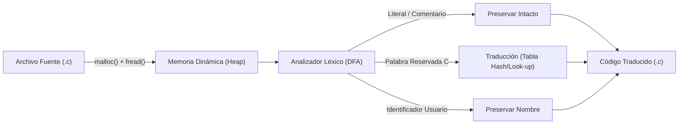

# Prueba Diagnóstica
### Lenguajes y Compiladores - Lapso 2026-II
**Universidad Nacional Experimental de Guayana (UNEG)**  
Coordinación de Ingeniería en Informática  

**Docente:** Msc. Félix Márquez  
**Equipo:** ParseCore  
**Eslogan:** *"Estructurando la sintaxis, optimizando la ejecución."*  
**Ponente:** Brayan Carreño | **C.I.:** V-32.015.527 | **Sección:** 01  

---

## Agenda de la Defensa (Máx. 5 Minutos)

1. **Ejercicio 1: Validación y Benchmark de Movimientos de Ajedrez (Caballo)**
   - Geometría de traslación en $L$ y autómata de validación.
   - Detección temprana de errores léxicos (`K`) y geométricos.
   - Benchmark comparativo $n=100$ y 10x 500 movimientos (C vs Python).

2. **Ejercicio 2: Polinomio $(x+1)^n$ y Triángulo de Pascal con Memoria Dinámica**
   - Asignación dinámica en Heap (`malloc` / `free`).
   - Prevención de desbordamiento de enteros para $n=100$ ($C(100,50) \approx 10^{29}$).
   - Evaluación paso a paso para $x \in \mathbb{R}$ y benchmark multilenguaje.

3. **Ejercicio 3: Analizador Léxico y Traductor de C a Español**
   - Carga dinámica de código fuente en memoria RAM.
   - Reconocedor léxico (DFA) con preservación estricta de cadenas y comentarios.
   - Reporte estadístico de frecuencias de tokens traducidos.

---

## Ejercicio 1: Validación del Caballo en Ajedrez 8x8

### Modelo Matemático
El caballo se desplaza en forma de "$L$". Desde $(c_1, r_1)$ hasta $(c_2, r_2)$:
$$\Delta x = |c_2 - c_1|, \quad \Delta y = |r_2 - r_1|$$
$$\text{Condición necesaria y suficiente: } \Delta x^2 + \Delta y^2 = 5 \iff (\Delta x \cdot \Delta y = 2 \land \Delta x + \Delta y = 3)$$

### Detección Precisa de Errores
- **Prefijo inválido:** Si $Pieza \neq 'K'$ (ej: `Qb4`):
  `movimiento INCORRECTO falla letra Q no pertenece a un caballo.`
- **Casilla fuera de rango:** $\Delta x, \Delta y \notin [0, 7]$ o salto ilegal:
  `INCORRECTO falla en el movimiento i.`
- **Secuencia íntegra:**
  `movimiento CORRECTO.`

---

## Ejercicio 1: Resultados y Rendimiento Multilenguaje

| Lenguaje | Tiempo $n = 100$ | Speedup Relativo | Prueba 10x 500 movs |
| :--- | :---: | :---: | :---: |
| **Lenguaje C (GCC -O3)** | **2.397 $\mu$s** (0.0024 ms) | **15.3x más rápido** | **0.1254 ms total** |
| **Python 3.12** | **36.730 $\mu$s** (0.0367 ms) | Referencia base (1.0x) | 1.7528 ms total |

### Justificación de Compilación y Arquitectura
- **C:** Acceso directo a punteros contiguos (`strtok`), operaciones a nivel de registros (`EAX`/`EBX`), sin recolección de basura ni encapsulamiento dinámico.
- **Python:** Evaluación interpretada (bytecode CPython) y sobrecarga en la instanciación de objetos inmutables `str`.

---

## Ejercicio 2: Polinomio $(x+1)^n$ y Pascal Dinámico

### Gestión Estricta de Memoria en C
```c
// Reserva dinámica de la fila siguiente en el Heap
BigInt* nueva_fila = (BigInt*)malloc((i + 1) * sizeof(BigInt));
// Cálculo aditivo de Pascal: C(n, k) = C(n-1, k-1) + C(n-1, k)
sumar_bigint(&fila_actual[j - 1], &fila_actual[j], &nueva_fila[j]);
// Liberación inmediata de la fila previa para prevenir fugas (Memory Leaks)
free(fila_actual);
fila_actual = nueva_fila;
```

### El Reto de $n = 100$
- El coeficiente binomial central $C(100, 50) = \mathbf{100.891.344.545.564.193.334.812.497.256}$ posee **29 dígitos**.
- Un entero de 64 bits (`uint64_t`) desborda en $n \ge 68$ ($2^{64}-1 \approx 1.84 \times 10^{19}$).
- **Solución implementada:** Estructura dinámica de alta precisión `BigInt` en C y Bignum nativo en Python.

---

## Ejercicio 2: Demostración y Benchmark ($n = 100$)

### Evaluación Paso a Paso para $x = 2.0$, $n = 4$:
$$f(x) = (x+1)^4 = x^4 + 4x^3 + 6x^2 + 4x + 1$$
$$f(2) = 16(1) + 8(4) + 4(6) + 2(4) + 1(1) = 16 + 32 + 24 + 8 + 1 = \mathbf{81.0}$$
*Verificación directa:* $(2 + 1)^4 = 3^4 = \mathbf{81.0}$ *(Error: $0.00 \times 10^0$)*.

### Métricas de Generación ($n = 100$):
- **Lenguaje C:** **184.43 $\mu$s** con reserva/liberación dinámica en Heap en cada iteración.
- **Python 3.12:** **194.37 $\mu$s**.

---

## Ejercicio 3: Analizador Léxico y Traductor C $\rightarrow$ Español



### Reglas Críticas del Compilador:
1. **Preservación Léxica:** Palabras clave dentro de cadenas (`"error: while loop"`) o comentarios (`// si n > 0`) **NO** se traducen.
2. **Identificadores Compuestos:** No traducir subcadenas (`contador_while` o `interfaz`).

---

## Ejercicio 3: Demostración de Traducción Léxica

### Código Fuente en C Original:
```c
int calcular(int n) {
    if (n <= 1) return 1;
    else return n * calcular(n - 1);
}
```

### Código Fuente Traducido a Español:
```c
entero calcular(entero n) {
    si (n <= 1) retornar 1;
    sino retornar n * calcular(n - 1);
}
```
*Estadísticas:* Carga dinámica en RAM (837 bytes), 43 identificadores escaneados, 17 palabras reservadas traducidas con éxito.

---

## Conclusiones Técnicas

1. **Rendimiento:**
   - La arquitectura en C supera a Python por un factor de **15.3x** en operaciones discretas de búsqueda y validación, debido a la ausencia de capas de abstracción e indirección.
2. **Gestión de Memoria:**
   - El uso riguroso de `malloc()` y `free()` garantiza la escalabilidad en estructuras combinatorias como Pascal y buffers de archivos fuente en análisis léxico.
3. **Robustez y Precisión:**
   - Se garantizó precisión arbitraria en $n=100$ evitando desbordamientos de enteros y se implementó un analizador léxico que respeta las normas de la gramática de C.

---

# ¡Muchas Gracias!
### Equipo ParseCore
*"Estructurando la sintaxis, optimizando la ejecución."*  
**Repositorio GitHub:** [github.com/Bryd3n/lyc-parsecore](https://github.com/Bryd3n/lyc-parsecore)
